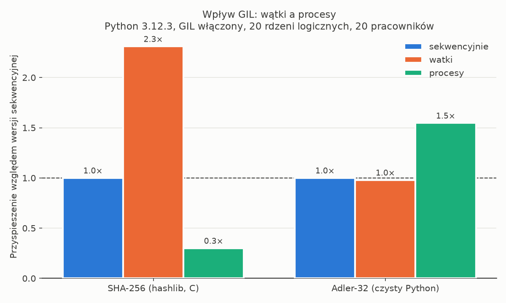

# Sprzątacz folderu

Program wyszukuje zduplikowane pliki we wskazanym folderze razem z podfolderami i pokazuje, ile miejsca można odzyskać po usunięciu zbędnych kopii. Pliki tymczasowe i systemowe są pomijane. Najpierw pliki są grupowane według rozmiaru, a następnie dla plików o tym samym rozmiarze liczony jest skrót SHA-256. Pliki o identycznym skrócie to duplikaty. Skróty można liczyć sekwencyjnie, w wielu wątkach albo w wielu procesach. W każdej grupie program wskazuje plik do zostawienia, czyli ten, którego nazwa nie wygląda na kopię (na przykład "raport.pdf" zamiast "raport (2).pdf" albo "raport - Kopia.pdf"). Wynik można zapisać do raportu w formacie TXT lub CSV.

Projekt zaliczeniowy z przedmiotu Zaawansowane techniki programowania w języku Python.

## Uruchomienie

Wymagany Python 3.12 lub nowszy. Sam program nie używa bibliotek zewnętrznych. Biblioteka matplotlib jest potrzebna tylko do wykresu w pomiarze wydajności.

| Komenda | Co robi |
|---|---|
| pip install -r requirements.txt | instaluje matplotlib (tylko do wykresu) |
| python narzedzia/generuj_dane.py | tworzy folder dane_testowe z plikami testowymi |
| python main.py dane_testowe | skanuje folder i wypisuje podsumowanie |
| python main.py dane_testowe -v | dodatkowo wypisuje grupy duplikatów i pominięte pliki |
| python main.py dane_testowe --tryb sekwencyjnie | liczy skróty plik po pliku |
| python main.py dane_testowe --tryb watki | liczy skróty w wielu wątkach (domyślnie) |
| python main.py dane_testowe --tryb procesy --pracownicy 4 | liczy skróty w 4 procesach |
| python main.py dane_testowe --raport wyniki/raport.txt | zapisuje raport tekstowy |
| python main.py dane_testowe --raport wyniki/raport.csv | zapisuje raport CSV (do otwarcia w Excelu) |
| python -m benchmarks.gil_benchmark | pomiar wydajności: sekwencyjnie, wątki, procesy |

## Struktura projektu

| Plik | Zawartość |
|---|---|
| main.py | punkt wejścia programu, argumenty wiersza poleceń |
| sprzatacz/wzorce.py | wyrażenia regularne |
| sprzatacz/skaner.py | skanowanie folderu za pomocą generatorów |
| sprzatacz/czytnik.py | iterator czytający plik kawałkami |
| sprzatacz/skroty.py | liczenie skrótów SHA-256 sekwencyjnie, wątkami i procesami |
| sprzatacz/dekoratory.py | własne dekoratory funkcji i metod |
| sprzatacz/raport.py | klasa Raport, zapis wyników do TXT i CSV |
| benchmarks/gil_benchmark.py | pomiar wpływu GIL, tabela i wykres wyników |
| narzedzia/generuj_dane.py | generator danych testowych |
| requirements.txt | biblioteki zewnętrzne (matplotlib) |

## Mapowanie zagadnień

| Zagadnienie | Gdzie w kodzie |
|---|---|
| Generator, yield from | sprzatacz/skaner.py → skanuj() |
| Potok generatorów | sprzatacz/skaner.py → skanuj(), filtruj(), grupuj_po_rozmiarze() |
| Wyrażenia generujące | main.py → main(), sprzatacz/raport.py → Raport.liczba_zbednych, Raport.miejsce_do_odzyskania |
| Regex, walidacja | sprzatacz/wzorce.py → PLIK_POMIJANY_RE |
| Regex, ekstrakcja z grupami nazwanymi | sprzatacz/wzorce.py → KOPIA_RE |
| Iterator | sprzatacz/czytnik.py → klasa CzytnikPliku |
| Wątki, synchronizacja Lock | sprzatacz/skroty.py → _licz_watkami(), klasa ZbieraczWynikow |
| Procesy | sprzatacz/skroty.py → _licz_procesami() |
| Dekorator funkcji, functools.wraps | sprzatacz/dekoratory.py → zmierz_czas, użyty na skroty.py → znajdz_duplikaty() |
| Dekorator z parametrami | sprzatacz/dekoratory.py → ponow(proby, opoznienie, wyjatki), użyty na skroty.py → oblicz_skrot() |
| Dekorator metody korzystający z self | sprzatacz/dekoratory.py → wymaga_duplikatow, użyty na raport.py → Raport.zapisz() |
| @property z setterem | sprzatacz/raport.py → Raport.format |
| @property | sprzatacz/raport.py → Raport.liczba_zbednych, Raport.miejsce_do_odzyskania |
| @staticmethod | sprzatacz/raport.py → Raport.wybierz_oryginal() |
| Pomiar GIL | benchmarks/gil_benchmark.py |

## Wyniki pomiarów

Pomiar wykonany komendą python -m benchmarks.gil_benchmark. Python 3.12.3 z włączonym GIL, procesor z 20 rdzeniami logicznymi, 20 wątków lub procesów, 174 pliki testowe (około 180 MB). Przed pomiarem wykonywana jest rozgrzewka, żeby wszystkie tryby czytały pliki z pamięci podręcznej systemu. Wynik to mediana z 3 powtórzeń. Czas obejmuje utworzenie puli wątków lub procesów.

Mierzone są dwa zadania wykonywane dla każdego pliku. SHA-256 z modułu hashlib to zadanie, które wykonuje program, a obliczenia odbywają się w kodzie C. Adler-32 to suma kontrolna napisana w czystym Pythonie (pierwsze 64 KB każdego pliku), więc każdy krok wykonuje interpreter.

| Zadanie | Tryb | Czas [s] | Przyspieszenie |
|---|---|---|---|
| SHA-256 (hashlib, C) | sekwencyjnie | 0.118 | 1.00× |
| SHA-256 (hashlib, C) | wątki | 0.051 | 2.31× |
| SHA-256 (hashlib, C) | procesy | 0.393 | 0.30× |
| Adler-32 (czysty Python) | sekwencyjnie | 0.679 | 1.00× |
| Adler-32 (czysty Python) | wątki | 0.694 | 0.98× |
| Adler-32 (czysty Python) | procesy | 0.439 | 1.55× |

## Wnioski dotyczące GIL

Przy liczeniu SHA-256 wątki dały przyspieszenie 2,31 razy, mimo że w CPythonie działa GIL. Dzieje się tak, ponieważ hashlib liczy skrót w kodzie C i na ten czas zwalnia GIL, więc kilka wątków może pracować równolegle. Przyspieszenie jest mniejsze niż liczba rdzeni, bo część pracy, czyli odczyt plików przez iterator i zapis wyników pod blokadą Lock, nadal wymaga GIL. Procesy przy SHA-256 były ponad trzy razy wolniejsze od wersji sekwencyjnej, ponieważ na Windowsie każdy proces uruchamia nowy interpreter i importuje moduły, a to trwa dłużej niż samo liczenie skrótów dla 180 MB danych. Przy Adler-32 w czystym Pythonie wątki nie dały żadnego zysku (0,98 razy), bo GIL pozwala wykonywać kod Pythona tylko jednemu wątkowi naraz i wątki pracowały na zmianę. Procesy przyspieszyły to zadanie 1,55 razy, ponieważ każdy proces ma własny interpreter i własny GIL i może liczyć na osobnym rdzeniu. Zysk z procesów jest mniejszy niż liczba rdzeni, bo całe zadanie trwa około 0,7 s, a start 20 procesów zajmuje znaczną część tego czasu. Wniosek dla programu jest taki, że do liczenia skrótów domyślnie używane są wątki, bo hashlib zwalnia GIL, a wątki startują prawie bez kosztu. Procesy opłacają się przy dłuższych obliczeniach napisanych w czystym Pythonie.
